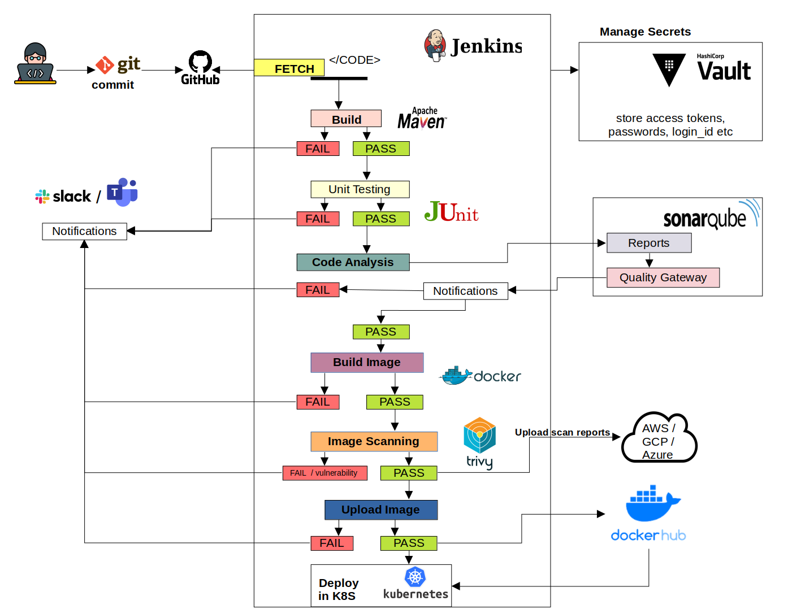

# End-to-End DevSecOps CI/CD Pipeline

I built this pipeline as my project for the C-DAC PG Diploma in IT Infrastructure, Systems and Security (PG-DITISS).

It takes a Java Spring Boot application from a Git commit all the way to a running deployment on Kubernetes. Security checks are part of every step: code analysis with a quality gate, container image scanning, and secrets pulled from HashiCorp Vault instead of being stored in the pipeline. Slack notifies the team whether each run passes or fails.

> **Credit:** This project is based on the reference project [praveensirvi1212/DevSecOps-project](https://github.com/praveensirvi1212/DevSecOps-project). The pipeline design and sample application come from that project. I set up, configured and ran the full toolchain myself. The changes in this version are listed [below](#changes-in-this-version).

**Project page:** https://shubhamvir.github.io/ditiss-project/

---

## Architecture



*Architecture diagram from the reference project.*

## Pipeline stages

| # | Stage | Tool | What it does |
|---|-------|------|--------------|
| 1 | Checkout | Git, GitHub | Pulls the latest code from this repository |
| 2 | Build and unit test | Maven, JUnit | Compiles the app, runs the unit tests and publishes the test results in Jenkins |
| 3 | Code analysis | SonarQube | Static analysis for bugs, code smells and security issues |
| 4 | Quality gate | SonarQube | Stops the pipeline if the code does not meet the quality gate |
| 5 | Docker build | Docker | Builds a multi-stage image that runs as a non-root user |
| 6 | Image scan | Trivy | Scans the image for known vulnerabilities (CVEs) and creates an HTML report |
| 7 | Upload report | AWS S3 | Stores the Trivy report in an S3 bucket for review |
| 8 | Docker push | Docker Hub, HashiCorp Vault | Gets the Docker Hub credentials from Vault at runtime and pushes the image |
| 9 | Deploy | Kubernetes | Deploys the app as a Deployment with a NodePort Service |
| - | Notify | Slack | Sends a success or failure message after every run |

## Tech stack

- **CI/CD:** Jenkins (declarative pipeline)
- **Build and test:** Maven, JUnit
- **Code quality and SAST:** SonarQube with PostgreSQL
- **Containers:** Docker, Docker Hub
- **Image scanning:** Trivy
- **Secrets management:** HashiCorp Vault (AppRole)
- **Cloud storage:** AWS S3
- **Deployment:** Kubernetes
- **Notifications:** Slack
- **Application:** Java 11, Spring Boot

## Repository structure

```
.
├── Jenkinsfile                     # The full CI/CD pipeline
├── Dockerfile                      # Multi-stage image build, non-root runtime
├── spring-boot-deployment.yaml     # Kubernetes Deployment and NodePort Service
├── pom.xml                         # Maven build file
├── src/                            # Spring Boot application and unit test
├── vars/helloWorld.groovy          # Example Jenkins shared library function
├── kubernetes-cd.hpi               # Kubernetes Continuous Deploy plugin (manual install)
├── Jenkins_installation.md         # Jenkins setup on Ubuntu 22.04
├── docker_installation.md          # Docker setup on Ubuntu 22.04
├── sonarqube_installation_with_postgres_database.md
└── Images/architecture.png
```

## How to run it

### 1. Install the tools

Set these up on Ubuntu 22.04. The guides in this repo cover the first three:

- Jenkins: [Jenkins_installation.md](Jenkins_installation.md)
- Docker: [docker_installation.md](docker_installation.md)
- SonarQube with PostgreSQL: [sonarqube_installation_with_postgres_database.md](sonarqube_installation_with_postgres_database.md)
- Trivy, the AWS CLI (with access to an S3 bucket), HashiCorp Vault, and a Kubernetes cluster (minikube works for testing)

### 2. Configure Jenkins

**Plugins:** SonarQube Scanner, HashiCorp Vault, Slack Notification, JUnit, Pipeline Stage View, and Kubernetes Continuous Deploy. The Kubernetes Continuous Deploy plugin is no longer in the Jenkins update centre, so upload `kubernetes-cd.hpi` from this repo under *Manage Jenkins > Plugins > Advanced settings > Deploy plugin*.

**Tools:** add a Maven installation named `maven-3.8.6`.

**SonarQube:** add a SonarQube server named `SonarQube-server`. Set the global environment variables `sonarurl` and `sonarlogin`. In SonarQube, add a webhook pointing to `http://<jenkins-host>:8080/sonarqube-webhook/` so the quality gate stage gets its result.

**Credentials:**

| ID | Type | Used for |
|----|------|----------|
| `vault-cred` | Vault AppRole credential | Reading the Docker Hub login from Vault |
| `kubernetes` | Kubeconfig | Deploying to the cluster |
| `slack-token` | Secret text | Sending Slack notifications |

### 3. Configure Vault, S3 and Slack

- In Vault, store the Docker Hub login as a KV secret at `secrets/creds/docker` with the keys `username` and `password`.
- In the `Docker Push` stage of the `Jenkinsfile`, replace `your-vault-server-ip` with your Vault address.
- S3 bucket names are globally unique, so change `s3://devsecops-project/` to your own bucket.
- Create a `#devops` channel in Slack and add the Jenkins app to it.

### 4. Run the pipeline

Create a Jenkins *Pipeline* job using *Pipeline script from SCM*, pointing at this repository and the `Jenkinsfile`. Run a build and follow it in the stage view.

When the deploy stage passes, the app is available at:

```
http://<kubernetes-node-ip>:30038
```

## Changes in this version

- The pipeline and Kubernetes manifest now use this repository and my Docker Hub image (`shubhamvir/spring-boot-app`).
- `docker login` now reads the password from stdin, so the password no longer appears in the build log or the process list.
- The Dockerfile now builds the app entirely inside the container. It no longer depends on files from an earlier Jenkins stage, and it uses maintained Eclipse Temurin base images instead of the deprecated AdoptOpenJDK ones.
- Committed build output has been removed and a `.gitignore` has been added.

## What I would improve next

Looking at this pipeline with a security review mindset, these are the changes I would make before using it in production:

- **Fail on serious vulnerabilities.** Right now Trivy only reports. Adding `--exit-code 1 --severity HIGH,CRITICAL` would stop vulnerable images from reaching Docker Hub.
- **Secure the Vault connection.** The pipeline talks to Vault over plain HTTP with SSL verification turned off. Vault should run over TLS with verification on.
- **Replace the deprecated deploy plugin.** I would deploy with `kubectl` or Helm, or move to a GitOps tool like Argo CD.
- **Add more scanning.** For example, secret scanning (Gitleaks) and dependency scanning (OWASP Dependency-Check) before the build.
- **Harden the Kubernetes deployment.** Add resource limits, a restrictive `securityContext` and a read-only root filesystem.
- **Upgrade the framework.** Spring Boot 2.4.5 is out of support, so it should move to a supported version.
- **Sign the images.** Sign images with cosign and deploy by digest instead of the `latest` tag.
